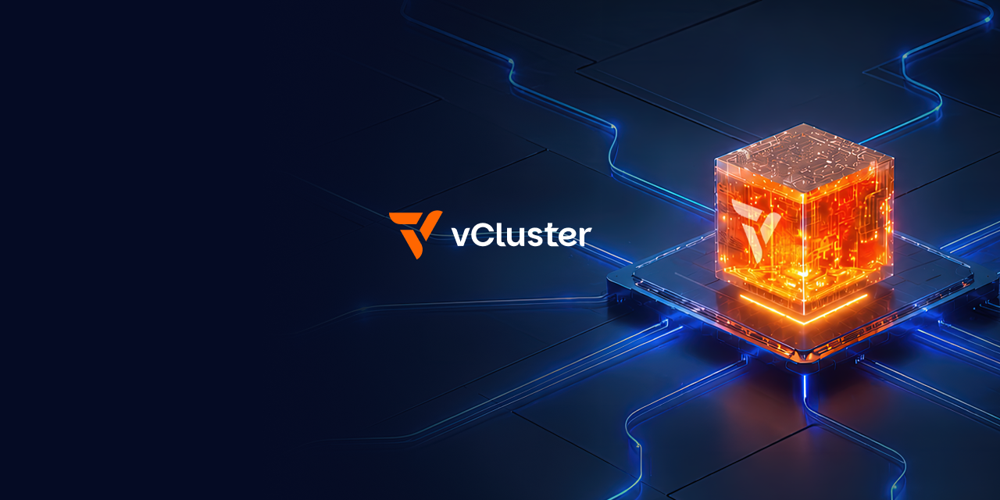

  

<h2 align="center">Run your AI cloud like a hyperscaler</h2>

One platform to turn raw GPUs into every kind of cluster, from bare metal up to Kubernetes, Slurm, inference, and more.

  <a href="https://www.vcluster.com/enterprise-demo"><b>Book a demo</b></a> ·
  <a href="https://www.vcluster.com/free"><b>Try vCluster</b></a> ·
  <a href="https://www.vcluster.com/docs"><b>Docs</b></a>

  
  &nbsp;&nbsp;
  

vCluster Labs is the platform operators use to build and run their own AI cloud, like a hyperscaler. vCluster turns raw GPUs into cluster products they can sell, from bare metal provisioning up through managed Kubernetes, Slurm, and inference clusters, with tenant isolation at the infrastructure layer.

## The Software-Defined AI Cloud

| Layer | Product | What it does |
|-------|---------|--------------|
| Cluster products | Kubernetes, Slurm, Run:ai, Ray, inference | What your customers buy, each delivered as an isolated tenant cluster |
| Tenant management | [vCluster Platform](https://www.vcluster.com/docs/platform) | Web UI, CLI, and API for tenants, projects, templates, capacity, and the clusters across them |
| Cluster orchestration | [vCluster](https://github.com/loft-sh/vcluster) | Provisions tenant clusters, each with its own virtualized control plane, on existing Kubernetes, standalone on bare metal or VMs, or in Docker |
| Infrastructure orchestration | [vMetal](https://vmetal.ai/) | Bare metal machines and VMs for every cluster you run, through one stable Machine API. Orchestrates Metal3, KubeVirt, NVIDIA NICo, and more |
| Application profiles | [vCluster Stacks](https://github.com/loft-sh/vcluster-stacks) | Versioned, health-gated application profiles deployed into a tenant cluster |
| Runtime isolation | [vNode](https://www.vnode.com/) | Container runtime that sandboxes pods with Linux user namespaces and seccomp. No hypervisor, no guest kernel |

Start turnkey with the vCluster UI and CLI, or call the APIs and put your own portal in front. No re-platforming either way.

## Built for every kind of builder

- **AI Cloud Providers:** Maximize revenue from every GPU you operate with managed clusters of every kind, and automate tenant, cluster, and bare metal provisioning end to end. [Learn more](https://www.vcluster.com/solutions/ai-cloud-providers)
- **AI Factories:** Give every AI team the GPU access they need, without multiplying your infrastructure.
- **Public and private cloud:** Provision clusters across EKS, GKE, AKS, bare metal, and private cloud, and shift workloads freely.

**100K+ GPUs powered · 1M+ CPUs powered · 50+ GPU clouds and Fortune 500s**

## Open source

vCluster started as open source and the core stays open. These are the projects to start with:

| Project | What it does |
|---------|--------------|
| [vcluster](https://github.com/loft-sh/vcluster) | The vCluster core: isolated clusters with their own API server, CRDs, and RBAC. CNCF Certified Kubernetes |
| [vind](https://github.com/loft-sh/vind) | vCluster in Docker. A kind alternative with sleep and wake, LoadBalancer services, and image caching |
| [cluster-api-provider-vcluster](https://github.com/loft-sh/cluster-api-provider-vcluster) | Manage vCluster with upstream Cluster API |
| [vcluster-sdk](https://github.com/loft-sh/vcluster-sdk) | Build custom syncers and plugins |
| [vcluster-stacks](https://github.com/loft-sh/vcluster-stacks) | Certified and community Stacks |
| [vcluster-docs](https://github.com/loft-sh/vcluster-docs) | Source for vcluster.com/docs. Contributions welcome. |

Try it in your browser on [Killercoda](https://killercoda.com/vcluster), or run it locally with vind.

**Legacy projects.** [DevSpace](https://github.com/devspace-sh/devspace), [DevPod](https://github.com/loft-sh/devpod), and [jsPolicy](https://github.com/loft-sh/jspolicy) came from our developer-tooling roots and are not part of the current product line.

## Community

- [Slack](https://slack.loft.sh/)
- [Blog](https://www.vcluster.com/blog)
- [LinkedIn](https://www.linkedin.com/company/vcluster)
- [X](https://x.com/vcluster)
- [YouTube](https://www.youtube.com/@vcluster)
- Security and compliance: [trust.vcluster.com](https://trust.vcluster.com/)
